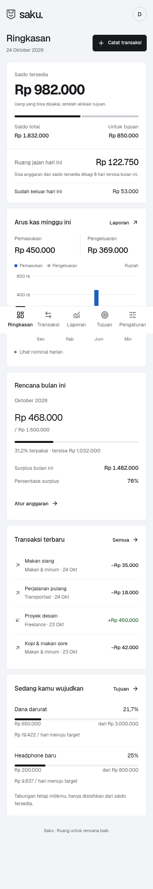
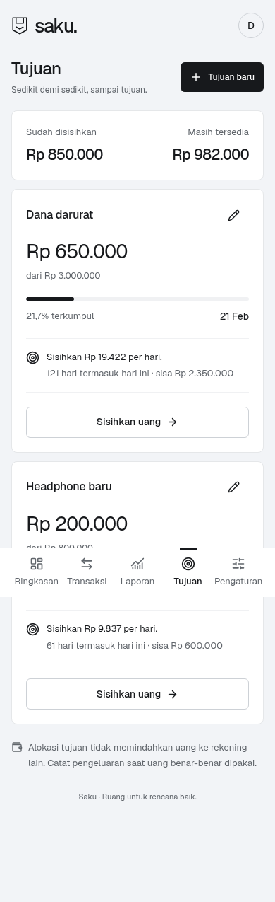

# Saku

Aplikasi Android pribadi untuk mencatat uang jajan, melihat arus kas, dan menabung dengan tujuan yang jelas. Bahasa Indonesia, mata uang rupiah, bekerja tanpa internet. React + TypeScript + Capacitor; tidak membutuhkan Supabase atau akun pengguna.

**[Unduh APK dari Releases](https://github.com/velorastudiodev-cpu/saku-android/releases/latest)** — repositori privat, masuk dengan akun GitHub pemilik. APK memerlukan Android 7.0 atau lebih baru dan Android System WebView yang diperbarui.

## Memasang

1. Unduh `Saku-1.0.0.apk` ke HP Android.
2. Buka file. Jika Android meminta, izinkan **Instal aplikasi tidak dikenal** untuk browser/pengelola file yang digunakan.
3. Pasang Saku dan isi nama, saldo awal, serta anggaran bulanan (opsional).
4. Cabut kembali izin pemasangan dari sumber tersebut setelah selesai.

Paket: `com.velorastudio.saku`. APK release ditandatangani dengan kunci pribadi Saku. Untuk pembaruan, gunakan paket dan kunci yang sama, naikkan `versionCode`, lalu pasang di atas aplikasi lama. Jangan hapus aplikasi sebelum memperbarui: data lokal ikut terhapus saat uninstall.

## Fitur

- **Ringkasan:** saldo total, saldo tersedia, alokasi tujuan, uang keluar hari ini, saran ruang jajan harian, dan ringkasan anggaran.
- **Transaksi:** tambah/edit/hapus pemasukan dan pengeluaran, tanggal, kategori, catatan, pencarian, filter jenis/bulan, dan ekspor CSV sesuai filter.
- **Laporan:** minggu kalender Senin–Minggu dan bulan kalender; grafik nominal harian, rincian kategori, porsi arus uang, surplus, persentase surplus, dan selisih dengan periode sebelumnya.
- **Tujuan:** nama, nominal target, tanggal target, progres, kebutuhan tabungan per hari, sisihkan atau kembalikan alokasi, edit, dan hapus.
- **Pengaturan:** nama, saldo awal, anggaran bulanan, ekspor JSON, dan pemulihan cadangan dengan validasi dan konfirmasi penggantian.

## Perhitungan

| Angka | Rumus |
| --- | --- |
| Saldo total | Saldo awal + seluruh pemasukan − seluruh pengeluaran |
| Saldo tersedia | Saldo total − jumlah alokasi semua tujuan |
| Surplus periode | Pemasukan periode − pengeluaran periode |
| Persentase surplus | Surplus ÷ pemasukan × 100%; tanda “—” jika pemasukan nol |
| Porsi arus uang | Masing-masing jenis ÷ (pemasukan + pengeluaran) × 100% |
| Kebutuhan per hari | Pembulatan ke atas dari sisa target ÷ hari sampai tenggat, termasuk hari ini |
| Ruang jajan harian | Nilai terendah saldo tersedia dan sisa anggaran ÷ hari tersisa dalam bulan; tanpa anggaran hanya saldo tersedia |

Alokasi tujuan bukan transaksi; tidak menambah atau mengurangi saldo total. Menghapus tujuan melepas alokasi ke saldo tersedia. Saat membeli barang tujuan, kembalikan alokasinya lalu catat pengeluaran sebenarnya. Nilai negatif tetap ditampilkan, dengan peringatan. Perbandingan periode memakai periode sebelumnya secara penuh; periode berjalan bisa belum selesai.

## Data dan privasi

Data disimpan dalam penyimpanan privat aplikasi melalui Capacitor Preferences. Tidak ada analitik, server, token GitHub/Supabase, atau pelacakan. Font dibundel lokal. Aplikasi tidak mengunggah catatan. Cadangan otomatis Android dinonaktifkan; **ekspor JSON secara berkala dan sebelum mengganti HP**. Simpan file cadangan di tempat pribadi karena isinya tidak dienkripsi. Proteksi akses mengikuti kunci layar/perlindungan perangkat; belum ada PIN terpisah dalam aplikasi.

Ekspor native membuka lembar berbagi Android agar file dapat disimpan/dikirim. Impor menggunakan pemilih file. CSV berguna untuk spreadsheet; JSON memuat seluruh data dan dipakai untuk pemulihan. Import JSON divalidasi (skema v1, tanggal valid, ID unik, nominal integer, kategori, alokasi, batas ukuran) sebelum mengganti data. Batas: 20.000 transaksi, 100 tujuan, dan Rp1 triliun per nominal.

## Pengembangan

```bash
npm ci
npm run dev
npm test
npm run test:e2e
npm run build
```

Node.js 22+, JDK 21, Android SDK platform 36 dan build-tools 36.0.0. Konfigurasi browser test menggunakan Chromium sistem `/usr/bin/chromium`; atur `PLAYWRIGHT_CHROMIUM_PATH` untuk lokasi lain atau pasang browser Playwright dengan `npx playwright install chromium`.

```bash
export ANDROID_HOME=/lokasi/android-sdk
export JAVA_HOME=/lokasi/jdk-21
export SAKU_KEYSTORE=/lokasi/privat/saku-release.jks
export SAKU_STORE_PASSWORD_FILE=/lokasi/privat/release-password.txt
bash scripts/build-android.sh
```

Kunci tanda tangan dan kata sandi tidak masuk repositori. Simpan cadangan kunci dari penyerahan aplikasi; kunci yang berbeda tidak dapat memperbarui APK lama. Build debug untuk pengembangan: `npm run android:sync`, kemudian `cd android && ./gradlew assembleDebug` (sertifikat berbeda dari release).

## Desain dan validasi

Ponytail full: satu aplikasi lokal tanpa server tambahan. Taste Skill: **Achromatic ledger**, seed **1792834316**, Geist lokal, latar buku kas, warna pada data, dan pemisahan saldo yang dapat dipakai dari tabungan tujuan. Keputusan ada di [rencana](docs/PLAN.md); hasil pemeriksaan di [validasi](docs/VALIDATION.md).

Data Dira pada screenshot/fixture adalah contoh pengujian, bukan data pengguna. APK selalu memulai dengan akun kosong. Fixture hanya di `tests/fixture.ts`; tidak diimpor kode produksi.




